# LuxTime

Plataforma de relojería de lujo. Reconstrucción del sitio estático de LuxTime: el mismo atelier de Ginebra, el catálogo de veinte referencias, las seis piezas de vitrina, la historia, el contacto y el cuaderno, ahora con ficha técnica, pedido y panel de taller.

Autor: [Santiago Gallo](https://github.com/santiagoGal7).

## Cómo ejecutarlo

Hacen falta Node.js 22 y dos comandos:

```bash
npm install
npm run dev
```

La tienda queda en `http://localhost:3000`.

Otros comandos:

```bash
npm test          # lógica de carrito, precio y filtros, más un test de componente
npm run lint
npm run format
npm run build
npm start
```

## Cuentas de demostración

La sesión vive en el navegador. No hay servidor de identidad.

| Uso                             | Correo                | Clave         |
| ------------------------------- | --------------------- | ------------- |
| Cliente, con pedidos de ejemplo | `cliente@luxtime.com` | `atelier1940` |
| Panel del atelier               | `atelier@luxtime.com` | `calibre1940` |

El pago acepta `4242 4242 4242 4242`, una caducidad futura y cualquier CVC de tres o cuatro dígitos. No hay pasarela y no se cobra nada: solo se guardan los últimos cuatro dígitos.

## Qué conserva del sitio anterior

| Antes                                                 | Ahora                                                                                      |
| ----------------------------------------------------- | ------------------------------------------------------------------------------------------ |
| Portada con destacados e historia                     | `/` con héroe, colecciones, vitrina, línea de tiempo, testimonios, cuaderno y preguntas    |
| Catálogo de 20 relojes, stock y precio                | `/catalogo`, las 20 referencias más Aether, Chronos, Luna, Solaris, Vortex y Eclipse       |
| Ficha del Clásico y de Elegance, con grabado y correa | `/producto/[slug]` para todas las piezas: galería, zoom, variantes, grabado y relacionadas |
| Historia de 1940 a 2025                               | `/historia`                                                                                |
| Contacto                                              | `/contacto`, el mensaje queda en el panel                                                  |
| Blog de tres notas                                    | `/blog` y `/blog/[slug]`, con los mismos autores y fechas, sin marcas ajenas               |

Se suman carrito persistente, lista de deseos, checkout simulado, historial de pedidos, boletín, FAQ y un panel para piezas, inventario, pedidos y un tablero con gráfico.

## Paleta

El negro con oro de la primera versión se sustituye por dos temas que comparten los mismos tokens.

El salón de día es el tema por defecto: marfil cálido (`#F4EFE6`), tinta verde casi negra (`#14211C`), verde botella (`#183A32`) para la acción y el latón (`#8C6A3D`) solo en el metal —la palabra TIME, los años, las reglas—. La vitrina de noche invierte el lienzo a un azul tinta (`#0C1822`), no a negro, y cambia el acento a champán (`#E4D2B8`) y el metal a platino (`#C6D2D8`). El botón del encabezado guarda la elección en el navegador.

El tema de día es el predeterminado. La tipografía es Fraunces en los títulos y Manrope en el texto, ambas en el repositorio con `font-display: swap` y una escala fluida. El héroe es la vitrina: fotografía inmediata y, en escritorio, el vídeo cuando el hilo está libre. El reloj en tres dimensiones vive más abajo y no se monta en el teléfono.

## Stack

Next.js 15 (App Router) y TypeScript. Las fichas y el cuaderno se generan en estático, y el mismo proyecto se publica en Vercel o en Netlify.

Tailwind CSS y una capa de interfaz al estilo shadcn/ui: Radix para diálogo, acordeón y etiqueta, `class-variance-authority` para el botón, y utilidades `cn`. El radio es recto y el oro `#D4AF37` solo pinta reglas, estados y el botón, como en el sitio original sobre el azul `#0D1B2A`.

Motion hace los revelados al entrar en pantalla. Lenis suaviza el scroll en la tienda y se apaga en el panel y cuando el sistema pide menos movimiento. No entra GSAP: con Motion y Lenis el movimiento ya tiene un solo criterio.

React Three Fiber dibuja el reloj del héroe con geometría propia. No hay un GLB externo: el archivo pesaría más y la escena cabe en el primer pantallazo. Si el navegador no tiene WebGL, la portada enseña una fotografía.

Zustand, con persistencia local, guarda carrito, deseos, sesión, pedidos, stock editado y mensajes. React Hook Form y Zod validan contacto, cuenta y checkout. No uso TanStack Query porque el catálogo de demostración es síncrono; la ruta `GET /api/catalogo` ya expone la semilla para un cliente remoto.

La frontera de datos está en `lib/repository.ts` (`CatalogRepository`). Hoy la implementa la semilla local. Mañana puede implementarla Supabase con la misma firma, sin rehacer las pantallas. Los cambios del panel siguen en `localStorage` a propósito: no hay base de pago en este ejercicio.

## Despliegue

**Vercel.** Importa el repositorio. El framework es Next.js. No hacen falta variables de entorno.

**Netlify.** El archivo `netlify.toml` fija Node 22, `npm run build` y el plugin `@netlify/plugin-nextjs`. En el panel de Netlify, el directorio de publicación lo resuelve el plugin; no hace falta una base de datos.

## Capturas

Escritorio, 1440 px:

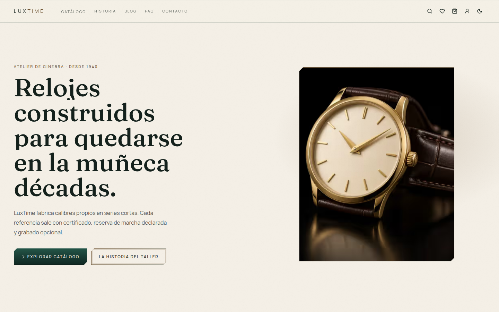

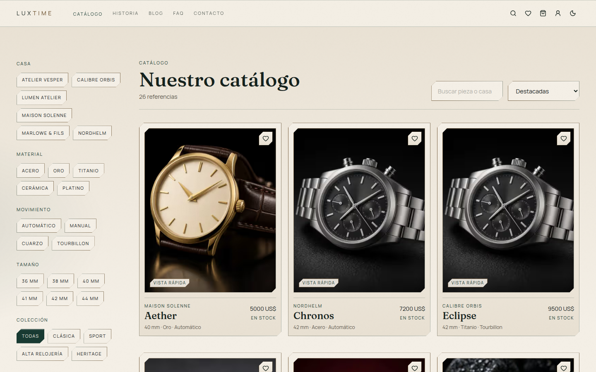

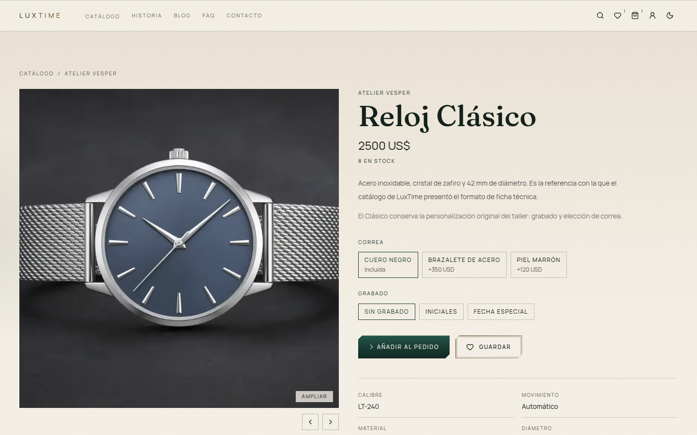

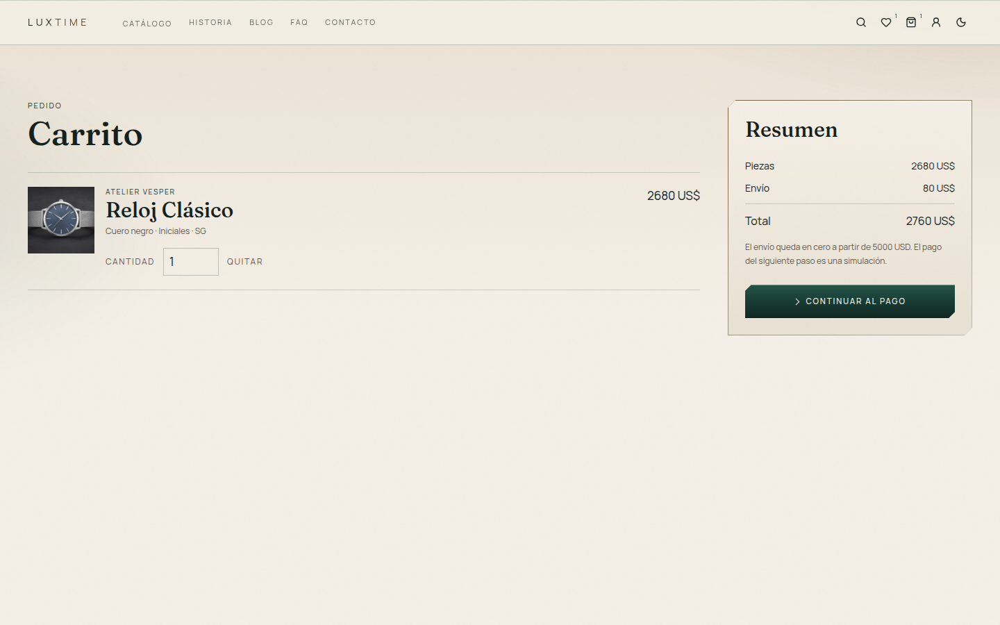

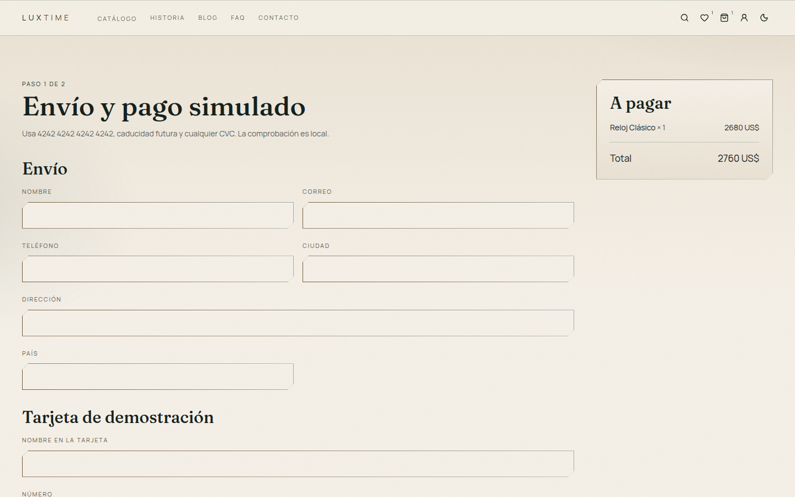

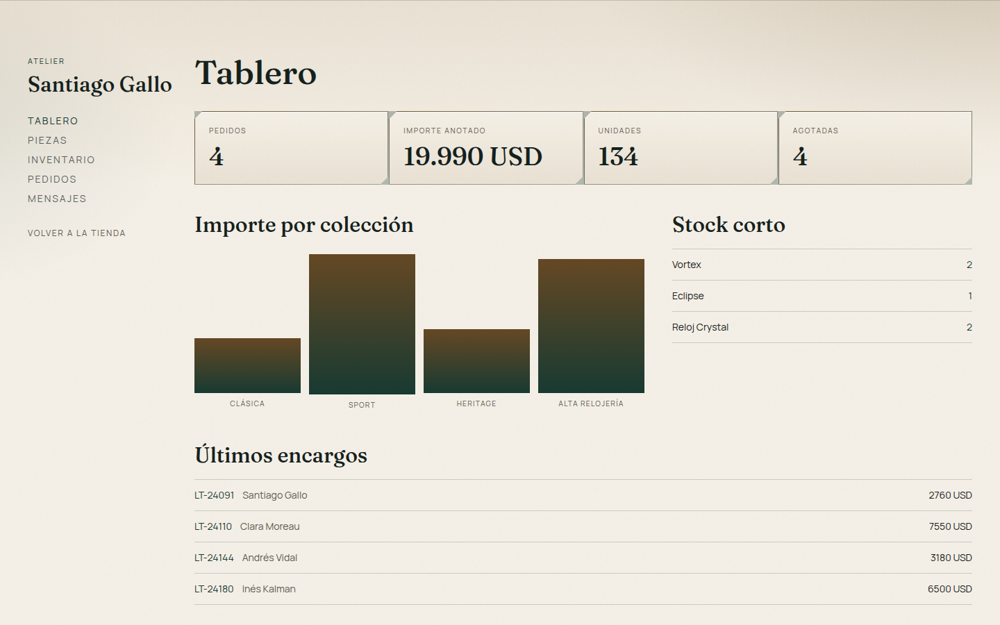

Móvil, 360 px:

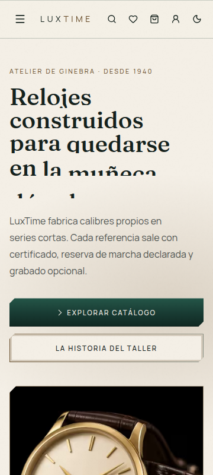

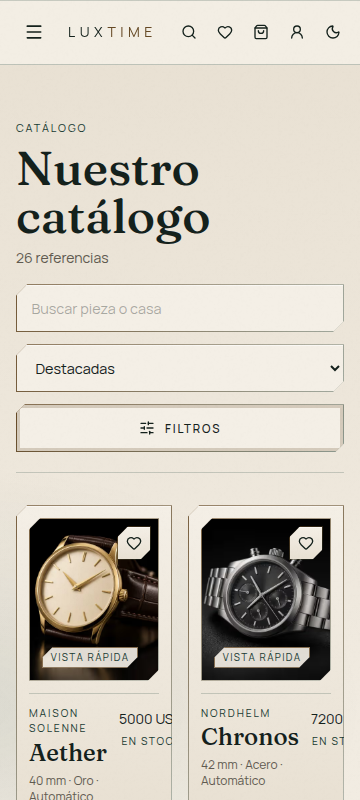

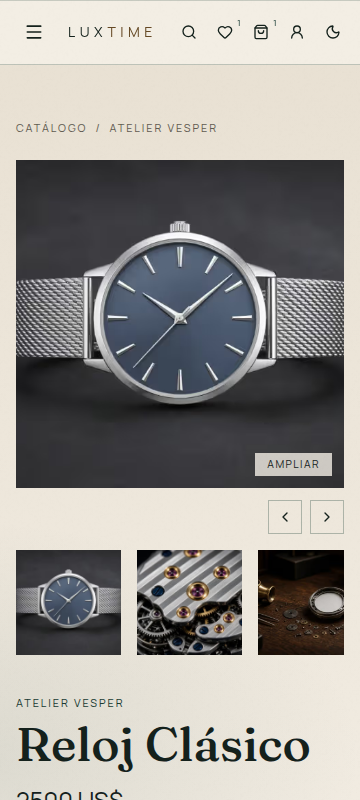

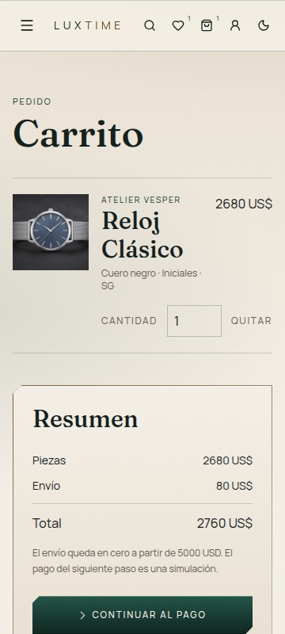

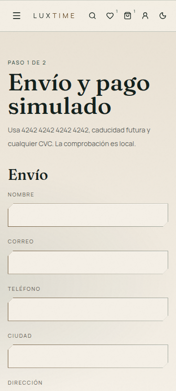

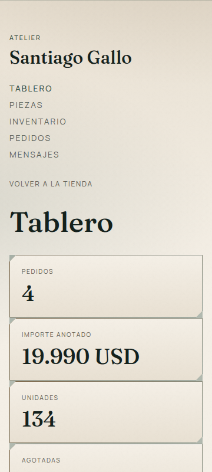

## Medios y marcas

Las casas del catálogo —Atelier Vesper, Maison Solenne, Nordhelm, Calibre Orbis, Lumen Atelier y Marlowe & Fils— son de este proyecto. Las esferas no llevan logos de manufacturas reales. El origen y la licencia de cada archivo están en [CREDITS.md](CREDITS.md).

## Contacto

[contacto@luxtime.com](mailto:contacto@luxtime.com) · desarrollo de [Santiago Gallo](https://github.com/santiagoGal7).
